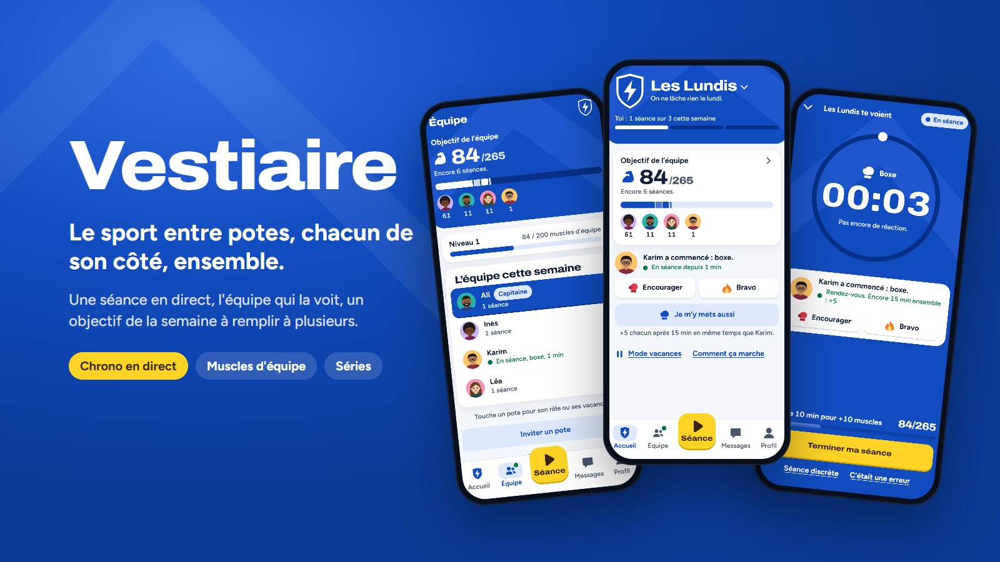
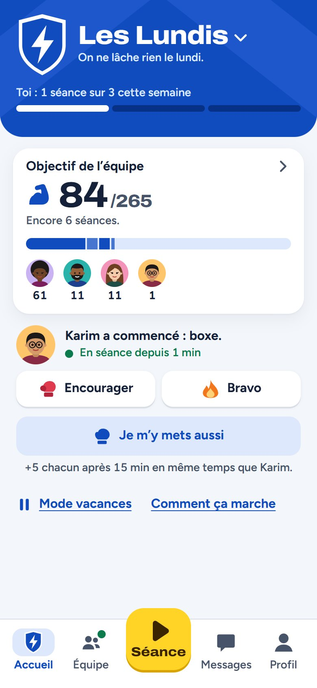
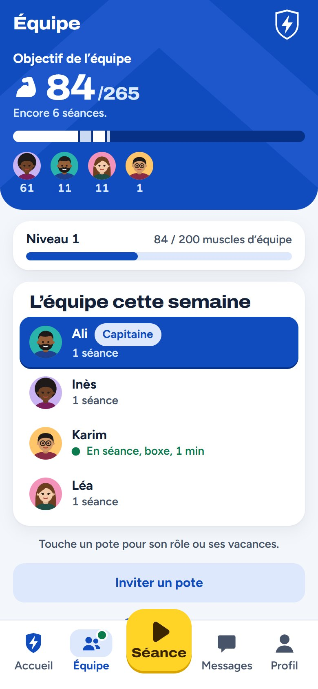
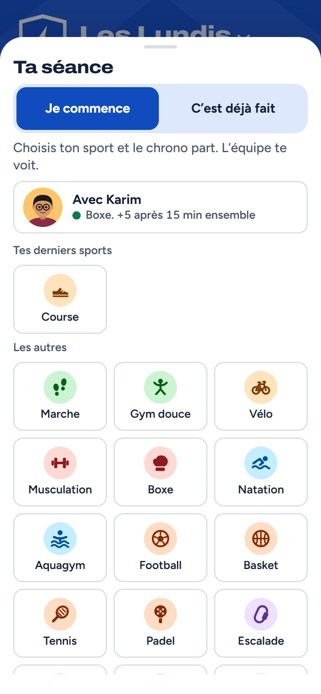
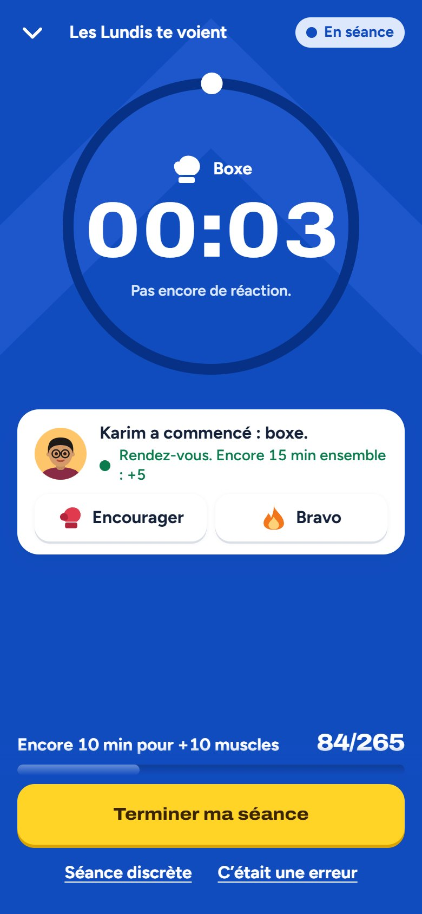
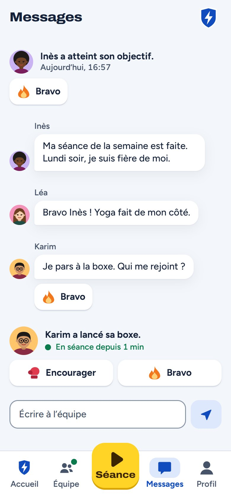
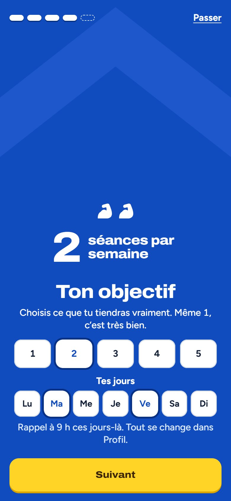
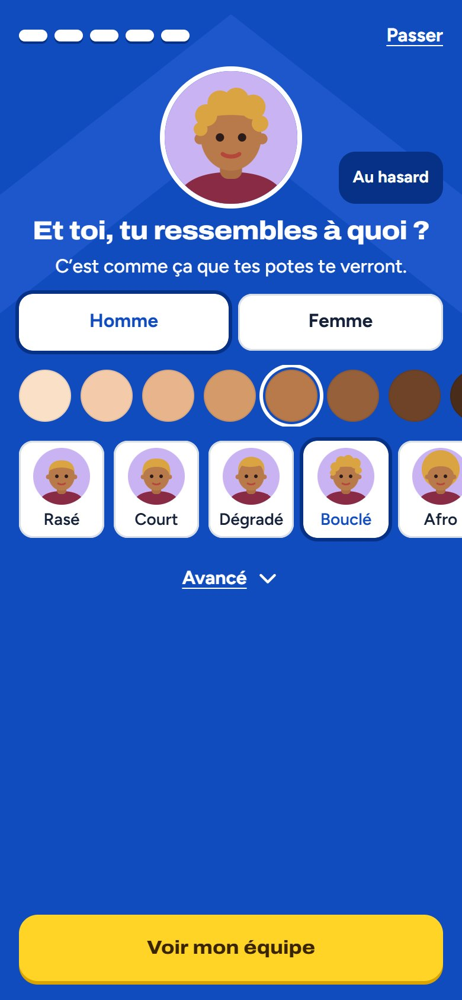
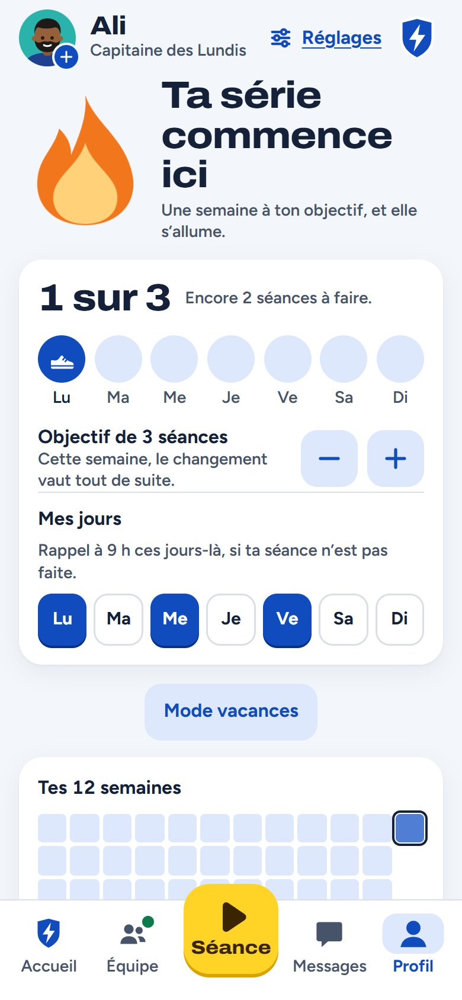

# VESTIAIRE

L'appli de sport entre potes : chacun de son côté, ensemble.

On lance sa séance, quel que soit le sport, et l'équipe la voit en direct. Chaque séance rapporte des muscles qui
remplissent l'objectif de la semaine, tenu à plusieurs. Vestiaire est pensée pour un petit groupe d'amis qui veulent
bouger plus sans habiter au même endroit ni faire le même sport : l'un court, l'autre va à la salle, une troisième
marche le midi, et tout compte pour l'équipe.

Le code source est privé. Cette page présente le projet. Les captures ont été prises le 2 novembre 2026 sur une
équipe d'essai.

## Ce que fait l'app

### L'équipe au centre

L'écran d'accueil, c'est le QG de l'équipe : son écusson, l'objectif de la semaine, qui est en séance en ce moment
et où j'en suis. L'objectif de l'équipe additionne l'objectif de chacun, en séances (« 13 séances au programme »),
puis dit ce qu'il reste à faire (« Encore 2 séances »). Le bonus de l'objectif tenu est plus gros pour un petit
objectif : qui prévoit une séance par semaine pèse presque autant que qui en prévoit cinq. Objectif atteint et
chacun a fait au moins une séance : la série de l'équipe monte.

  
  

### La séance en direct

Un appui sur Séance, un sport, et le chrono part. L'équipe le voit tout de suite, encourage, et peut se lancer
avec soi d'un appui : deux potes en séance au même moment pendant 15 minutes gagnent un bonus chacun. Réduite, la
séance reste en bas de l'écran comme un lecteur de musique, et dans les notifications du téléphone. Une séance
oubliée s'ajoute à la main, une séance discrète ne se montre à personne, et le chrono tient même sans réseau.

  
  

### Les potes

Le fil de l'équipe réunit les messages, les séances et les grands moments. On encourage, on dit bravo, on remercie,
et on chambre gentiment si l'équipe a choisi le ton Chambrage plutôt que Motivation. À partir du jeudi, on peut aussi
faire signe à un pote qui n'a pas encore tenu son objectif : un « On y va ? », une fois par jour au plus.

  

### Le jeu de la semaine

- **Séries** : une série d'équipe et une série perso. Des jokers se gagnent avec les semaines tenues, et une série
  tombée se répare la semaine suivante.
- **Duel** : chaque semaine, son équipe contre une autre, en pourcentage de l'objectif. Une victoire rapporte, une
  défaite ne coûte rien.
- **Ligue** : un classement sur les muscles par membre, où l'on monte et descend de division.
- **Binôme** : un pote tiré au sort, avec un but à tenir à deux.
- **Bilan du lundi** : le récit de la semaine écoulée, ce qui a été fait et jamais ce qui a manqué. On y choisit ses
  jours de la semaine qui commence, et on peut en faire une image ou un clip vidéo à partager.

Ces jeux apparaissent au fil des semaines, pour qu'une nouvelle équipe ne voie pas tout d'un coup.

### Pour chacun

- **Objectif et jours** : de 1 à 7 séances par semaine, et ses jours d'entraînement. Ils font le plan de chaque
  semaine, l'équipe les voit, et un rappel arrive ces jours-là si la séance n'est pas encore faite.
- **Vacances** : vacances, blessure ou autre, personne n'a à dire pourquoi. L'objectif s'efface, l'équipe n'est pas
  pénalisée et la série ne bouge pas. Le Capitaine peut aussi y mettre un pote qui n'ouvre pas l'appli.
- **Avatar et écusson** : un avatar dessiné en trois choix (homme ou femme, peau, coupe), et bien plus avec
  « Avancé ». Un écusson d'équipe à composer : formes, emblèmes, motifs et couleurs.
- **Profil** : sa semaine jour par jour, ses douze dernières semaines, sa série et son historique.

  
  
  

## Les règles du jeu

- **Jamais de récompense à la performance.** Ni la durée, ni la charge, ni la distance : une marche de 20 minutes
  vaut une séance de boxe.
- **Une seule monnaie, les muscles.** Ils font avancer l'équipe et ne se perdent jamais, même sur une défaite.
- **Chacun pèse presque autant.** Le débutant à une séance par semaine compte presque autant que l'habitué à cinq.
- **Personne n'a à se justifier.** Les vacances se prennent en deux appuis, sans motif.
- **Peu de notifications.** Deux par jour et par équipe au plus, des heures calmes la nuit, et le reste attend un
  seul résumé du soir.

## Côté technique

- **Application** : React 19 et TypeScript, Vite. Une appli web qui s'installe sur l'écran d'accueil (PWA) avec
  un service worker, sur iPhone comme sur Android, sans passer par un store. Mode sombre, sons composés pour
  l'appli, vibrations, et animations qui respectent le réglage « mouvement réduit » du téléphone.
- **Serveur** : Node.js 24, qui exécute TypeScript sans compilation, Hono et SQLite (`node:sqlite`). Le direct
  (séances, réactions, messages) est poussé aux téléphones par Server-Sent Events.
- **Règles du jeu** : muscles, objectifs, séries, duel, ligue, binôme et rappels vivent dans une bibliothèque
  partagée entre l'appli et le serveur. Tout se recalcule depuis la liste des séances : une séance arrivée en
  retard ou supprimée donne le même résultat que si elle avait été là dès le début.
- **Notifications** : Web Push, avec des boutons d'action (encourager un pote sans ouvrir l'appli), un budget par
  jour, des heures calmes et un résumé du soir.
- **Comptes** : un prénom et un code, sans adresse e-mail. Un pote invité arrive directement dans l'équipe par un
  lien, avec un aperçu à l'image de l'équipe dans les messageries.
- **Clips** : les clips de séance et de semaine sont filmés dans le navigateur, avec le son, prêts à partager.
- **Tests** : plus de 600 tests automatisés, et un parcours robot de 55 étapes qui rejoue l'appli sur des écrans
  de téléphone, de l'inscription au bilan du lundi.

## État du projet

Prototype complet, en test privé entre potes sur une adresse de test. L'appli web passe d'abord l'épreuve d'un
vrai groupe ; une version native viendra si les équipes tiennent dans la durée. Interface en français.

---

Projet d'Ali, [github.com/Ali213000](https://github.com/Ali213000). Code privé, tous droits réservés.
